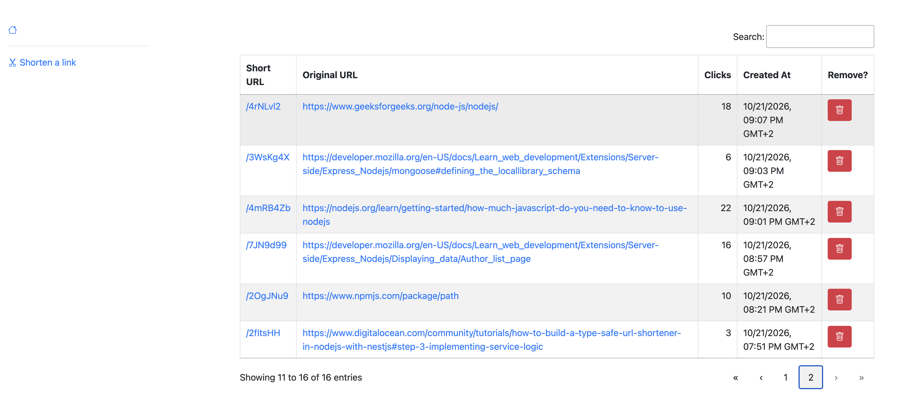
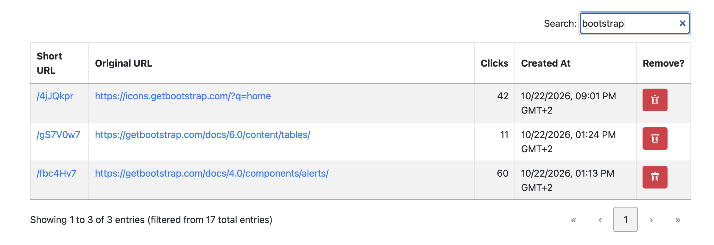
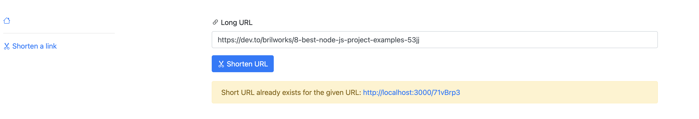
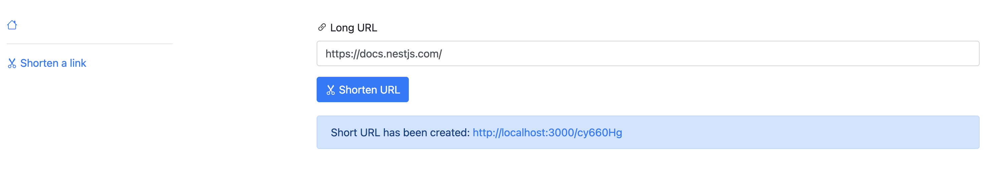
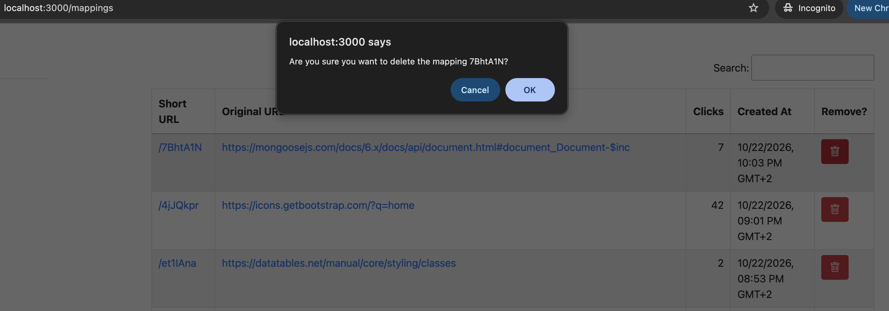
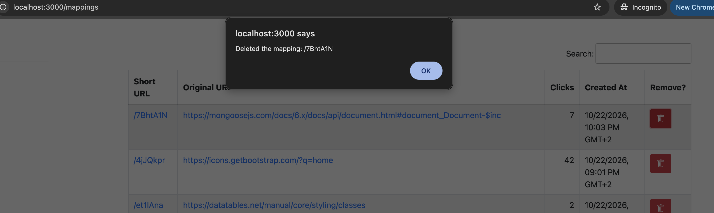

# URL Shortener

## Description

A service that allows users to transform long URLs into shorter, more manageable links.
It is built with Node.js, Express.js, MongoDB (Mongoose), and Pug view engine.
[DataTables](https://datatables.net/) jQuery plugin is used for displaying the list of shortened URLs.

## Quick Start

To get this project up and running locally on your computer:

1. Set up Node.js development environment.
2. Once you clone the project repository, install dependencies:

   ```bash
   npm install
   ```

3. Configure environment variables:
   - Create a `.env` file in the project root directory.
   - Add the following variables:
     ```
     NODE_ENV=development
     PORT=3000
     DATABASE_URL=<your_mongodb_uri>
     SHORT_URL_DOMAIN=<your_domain>
     ```
     You can use `http://localhost:3000` for `<your_domain>` when running locally.

4. Run the server:

   ```bash
   npm run serverstart
   ```

5. Open <http://localhost:3000/> in your web browser.

## Scaling Considerations
1. ID generator has to be improved. When a web server scales out, each server will generate its own 
IDs, leading to potential conflicts. A distributed ID generation strategy, such as using a 
centralized service or Twitter Snowflake approach, should be implemented.
2. Load balancer should be used to distribute incoming requests across multiple servers. On that
server, the response compression as well as SSL termination should be implemented.
3. Since the number of reads is significantly larger than writes, and there's no option to modify 
(shortUrl, longUrl) pairs, the most frequently accessed short URLs should be cached (eg. Memcached)
4. Database sharding should be considered to distribute the data across multiple servers, 
improving scalability and performance.
5. The currently used rate limiter (express-rate-limit) should be replaced with another one that is
based Sliding Window Counter algorithm.

## Screenshots









